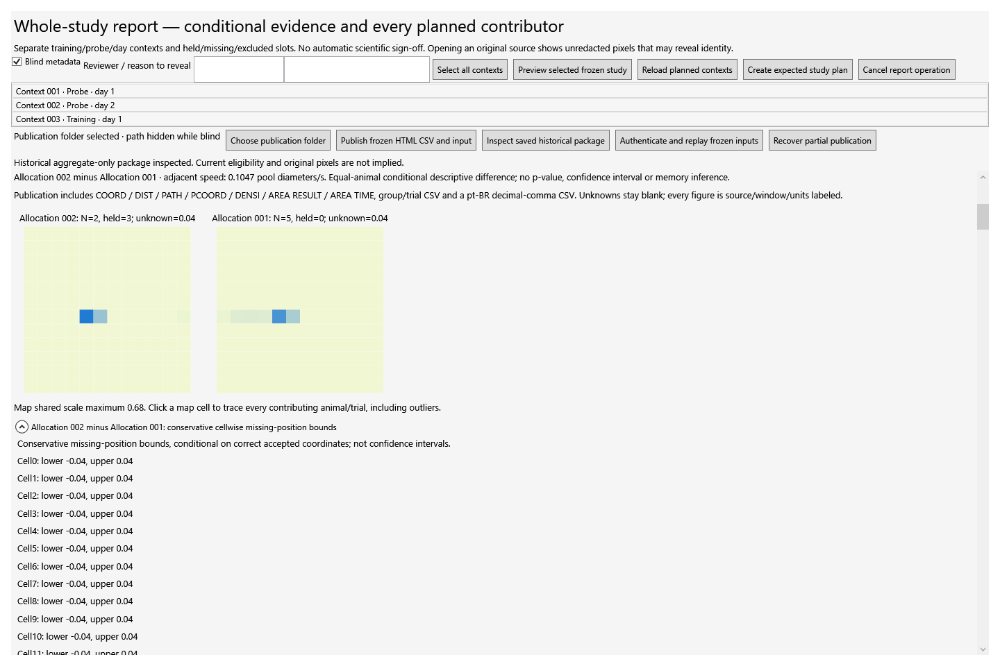

# RatoObservatorTabajara

**Mouse Tracker Tabajara** is a native Windows WPF application for tracking mice in water-maze recordings and reviewing a complete collection of trials.

## Download and run

[**Download the Windows Setup.exe**](https://github.com/pcarvalho75/RatoObservatorTabajara/releases/download/v0.1.0-dev.13/RatoObservatorTabajara-Setup-0.1.0-dev.13.exe), open it, and follow the installation wizard. Start the application from **Rato Observator Tabajara** in the Windows Start Menu. No .NET SDK or Python installation is required.

The installer places the complete app and runtime files in a new folder for your Windows user, without administrator access. Save processed projects outside the application folder. Before changing from an older version, save a processed-project checkpoint and close that version; open your saved project in the new version.

The application checks GitHub for updates automatically at startup and every 12 hours while open. **Updates** in the sidebar offers manual checks, pilot/stable channel settings, verified download/prepare and restart. Restart keeps a pristine rollback checkpoint, opens a separate working copy, preserves blind mode and waits for the new process to confirm startup before closing the old window. See [automatic updates](docs/delivery/AUTOMATIC-UPDATES.md).

Version dev.12 predates automatic updates and needs this one manual installation. The [release page](https://github.com/pcarvalho75/RatoObservatorTabajara/releases/tag/v0.1.0-dev.13) also offers a portable ZIP; extract that whole ZIP and run its launcher if you prefer the portable form.

Use **plain ASCII absolute video paths**, including parent folders, such as `D:\TabajaraVideos\mouse01-day1-trial1.mp4`. Spaces and CSV-quoted commas are supported. UTF-8 trial metadata is supported. The native decoder currently rejects accented video paths.

## Collection workflow

- Track dark mice with selectable detection polarity, inspect detection masks, and review positions against original video frames.
- Import multiple videos through a CSV preview with identity, duplicate and conflict checks. Each video represents one trial.
- Organize animals, experimental groups, days, trials and platform conditions in a planned study roster. Missing, excluded and held trials remain visible.
- Cancel processing safely, save a processed-project checkpoint, and reopen it to reuse completed compatible analyses. Resumption is between videos. Original videos remain external and are required for playback or reprocessing.
- Review trajectories, coordinate plots, heatmaps, area/distance outputs, animal-level group comparisons and endpoint eligibility.
- Export frozen HTML, CSV and SVG reports with replayable input snapshots and integrity manifests.

The supplied protocol guide describes four groups: treated wild types, vehicle wild types, treated mutants and vehicle mutants. Each animal has six days: visible platform with a flag; visible without a flag; three hidden-platform days; and a final probe with the platform removed. Four trials on each of days 1–5 and one probe on day 6 produce **21 planned videos per animal**. Real animal IDs and allocations must be entered and reviewed locally.

Start with [the collaborator test guide](docs/delivery/COLLABORATOR-TEST.md), [study intake](docs/delivery/STUDY-INTAKE.md), [protocol](docs/delivery/LUCIANA-PROTOCOL.md) and [question/output coverage](docs/delivery/QUESTION-COVERAGE.md).



The image shows a **synthetic demonstration**, not experimental results. See [additional native plots](docs/delivery/SHOWCASE.md).

## Validation and current scope

This is an **unsigned collaborator-test prerelease**. The retained release receipts aggregate **344 baseline passing checks across nine test projects, plus 39 focused updater checks and a native handoff proof**, with zero failures or skipped checks in those accepted receipts. They include separate corrective reruns, rather than a claim that every earlier run passed.

The previous dev.12 Windows package passed local startup/reopening and a synthetic 30-video collection exercise: ten completed analyses were saved, reopened in a separate process and reused while twenty further videos were processed. The four-animal fixture preserved 84 planned slots, 30 mapped videos and 54 explicitly missing slots. Frozen report reconstruction and the specific dev.7 → dev.12 backup/new-copy/rollback exercise passed.

Synthetic regression establishes software behavior within those checks. Real tracking accuracy, a clean collaborator computer, biological design confirmation and researcher sign-off require collaborator testing. Unsupported endpoints are held; unknown positions are not interpolated into invented paths. The app's reports distinguish repeated trials from independent animals. See [validation details](docs/delivery/RELEASE-VALIDATION.json) and [report boundaries](docs/delivery/REPORT-BOUNDARIES.md).

The historical roadmap and development documents retain their original scope and may describe earlier packages. This README and the release notes describe the published dev.12 package.

## Source and build

Application source is C#/.NET 10 with WPF. The initial public snapshot comes from the corresponding source of local release commit `d94644838208`. Public documentation and the package-bound proof helper are updated separately; the production code matches the tested package. Dependency lockfiles include the derived Windows x64 runtime graph.

On Windows with the pinned .NET SDK from `global.json` and NuGet access/cache:

```powershell
pwsh -NoProfile -File scripts/delivery/Replay-Build.ps1 -OutputDirectory C:\TabajaraBuild
```

For source checks, use `scripts/build.ps1` and `scripts/test-features.ps1`. Some development reference-image checks require locally supplied reference inputs, which are not distributed. The running application does not depend on those private development inputs. [Build details](docs/delivery/BUILD.md) explain the isolated snapshot/publish process.

## License and attribution

Application code is **GPL-3.0-or-later**. Tracking operations were ported from Olivier Friard's [DORIS](https://github.com/olivierfriard/DORIS), preserving its copyright, license and pinned source attribution. See [LICENSE.txt](LICENSE.txt) and [source provenance](docs/SOURCE-PROVENANCE.txt).

The release includes dependency notices and retained native codec source evidence. The full native toolchain/compliance audit remains open; the release does not claim a completed audit. Experimental recordings, private study databases, private reference trajectories, credentials and internal worker logs are excluded from publication.
